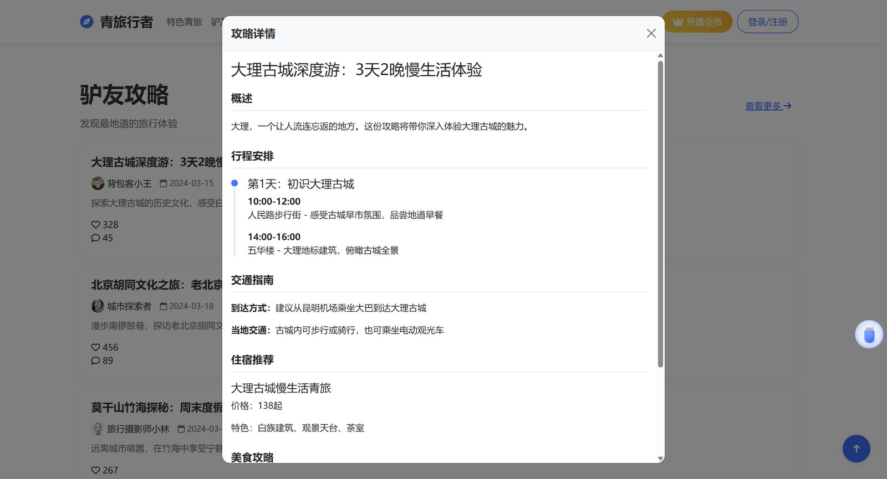
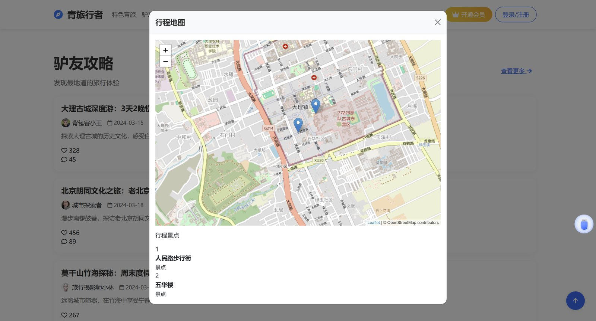
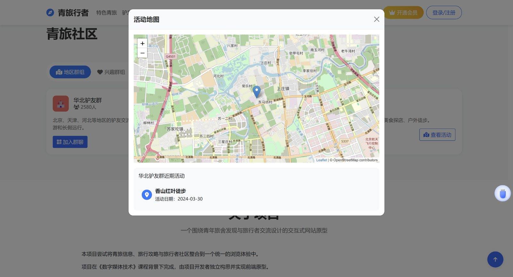
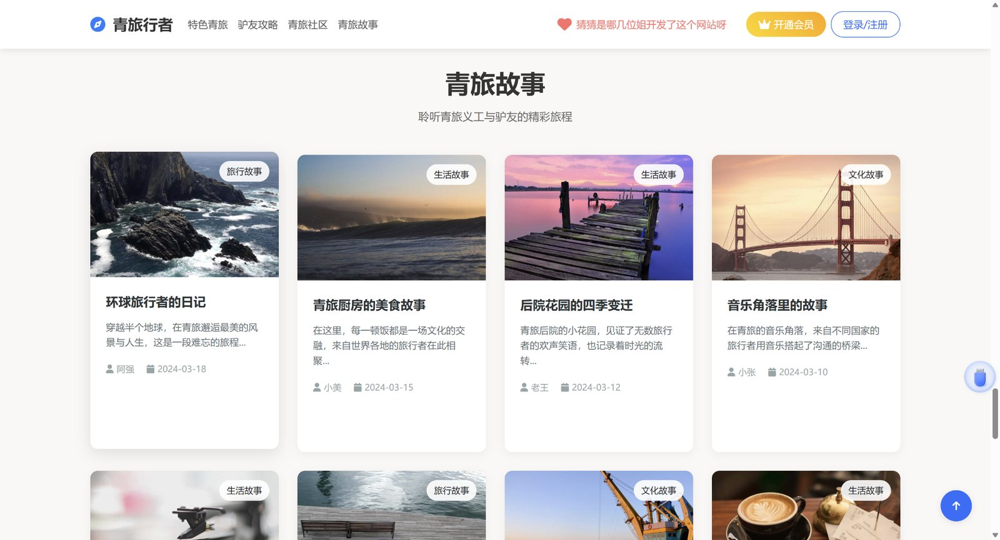

# Qing Traveler — Hostel Discovery & Travel Community Platform

An AI-assisted, single-page front-end prototype exploring how hostel discovery, travel guides, map-based browsing, and traveller community interfaces can be brought together in one place.

**[View Live Demo](https://xieyanqi.github.io/hostel-discovery-platform/)** · **[GitHub Repository](https://github.com/xieyanqi/hostel-discovery-platform)** · **[Technical Project Portfolio (PDF)](docs/technical-project-portfolio.pdf)**

## Project at a glance

| | |
|---|---|
| **Project context** | Digital Media Technology course group project |
| **My contribution** | Primary responsibility for product conceptualisation, requirements planning, and core front-end implementation |
| **Development approach** | Comprehensive initial website prompt in Cursor, followed by review and iterative code modification |
| **Project type** | Static front-end prototype |
| **Data** | Demonstration data; no live accommodation, booking, or community data services |
| **Deployment** | GitHub Pages |

Qing Traveler grew out of a problem I encountered while independently travelling: hostel information and traveller recommendations were scattered across multiple platforms. The project explores a more integrated browsing experience for discovering hostels, reading travel guides, viewing locations, and exploring traveller communities.

## Main interfaces

The screenshots below show the prototype's main pages and selected detail views. All displayed listings, reviews, stories, groups, and activity information are demonstration content.

### Homepage


### Hostel discovery and details


### Travel guides and itinerary






### Traveller community




### Travel stories



## Features and verification status

| Module | What the prototype includes | Status / qualification |
|---|---|---|
| Homepage | Destination carousel and navigation to the main sections | Interface implemented |
| Hostel discovery | Hostel cards with region, price-range, and category filters | Filtering tested and confirmed |
| Hostel details | Rating dimensions, review tags, sample reviews, and detail modal | Demonstration content |
| Travel guides | Guide cards and detailed itinerary views | Demonstration content |
| Map-based browsing | Leaflet maps with markers at predefined coordinates | Location visualisation; no live route planning |
| Traveller community | Regional/interest group examples and activity-map interface | Demonstration content |
| Join Group | Join-group control is present in the interface | Not tested as a complete user flow; current handler is a placeholder |
| Travel stories | Story cards populated by a simulated asynchronous function | Fixed demonstration dataset |

## Technology stack

| Technology | Role |
|---|---|
| HTML5 | Single-page structure and interface markup |
| CSS3 | Layout, styling, responsive breakpoints, and animations |
| Vanilla JavaScript | Data structures, DOM rendering, filtering, event handling, and modal updates |
| Bootstrap 5.1.3 | Layout utilities, modal components, and UI styling |
| Leaflet 1.7.1 | Interactive map views and location markers |
| OpenStreetMap | Map tile layer |
| Swiper 8 | Homepage destination carousel |
| Font Awesome 6 | Interface icons |
| Cursor | AI-assisted initial code generation and iterative code modification |

The libraries are loaded from CDNs. The project does not use React, Vue, a server-side framework, or a bundling/build pipeline.

## How the front end works

1. `index.html` defines the single-page structure and loads the external libraries, `styles.css`, and `main.js`.
2. `main.js` contains the active demonstration datasets, including `allHostels`, `travelGuides`, `communityData`, and `carouselData`.
3. Rendering functions create hostel, guide, and community interface elements from JavaScript data structures.
4. `applyFilters()` filters the hostel data by region, price range, and category, then re-renders the listing.
5. Leaflet creates map views and markers from predefined latitude/longitude values.
6. Bootstrap modals display hostel details, guide details, and map views.

**Data-source note:** `data/hostels.js` is retained in the repository but is not imported by the current `index.html`. The active hostel listing data is defined in `main.js`. The content shown throughout the prototype is demonstration data.

## AI-assisted development workflow

I prepared a comprehensive initial website specification covering the product concept, visual direction, page structure, main modules, and expected interactions, and submitted it to Cursor as the initial prompt. Cursor generated the main website structure and code. I then reviewed the generated pages, compared them with the intended product experience, and used further prompts to request code modifications.

The workflow was:

1. Identify the travel-information problem and define the product concept.
2. Write a comprehensive initial product and interface specification.
3. Use Cursor to generate the main website structure and code.
4. Review the generated website and evaluate it against the intended requirements.
5. Request iterative modifications through Cursor.
6. Check selected interactions and publish the static prototype through GitHub Pages.

The original Cursor chat history and intermediate code versions were not retained. This workflow description is based on my recollection and the preserved initial product brief, not reconstructed chat logs.

## My contribution

Although this was completed in a course group-project setting, I took primary responsibility for the substantive product concept and core front-end work. My contribution included:

- Identifying the user problem through my independent travel experience.
- Defining the product direction and major functional requirements.
- Preparing the comprehensive initial website specification.
- Using Cursor to generate the main website structure and code.
- Evaluating the generated pages and directing subsequent code modifications.
- Reviewing the source structure and testing the hostel filtering interaction.
- Preparing the project documentation and publishing the prototype through GitHub Pages.

The project was AI-assisted. My role is best described as product conceptualisation, requirements definition, AI-assisted development direction, evaluation, and refinement—not as independently hand-writing every line of code.

## Scope and limitations

This repository contains a front-end prototype, not a production booking or social platform.

- Hostel listings, ratings, reviews, guides, community groups, activity information, and stories use demonstration or hard-coded data.
- There is no server-side database, persistent account system, or production authentication.
- There is no live booking API, payment provider, or verified room inventory.
- The join-group control does not complete a real group-joining flow.
- Map markers use predefined coordinates; route optimisation, turn-by-turn navigation, and live tracking are not implemented.
- Some secondary controls and source-code paths remain incomplete. See the source-code review for details.
- A JavaScript syntax check (`node --check main.js`) passes; full browser-based regression testing has not been completed.

## Run locally

The project is static and requires no build step.

```bash
git clone https://github.com/xieyanqi/hostel-discovery-platform.git
cd hostel-discovery-platform
python -m http.server 8000
```

Then open `http://localhost:8000` in a browser. An internet connection is required for the CDN libraries, remote images, and OpenStreetMap tiles.

## Repository structure

```text
hostel-discovery-platform/
├── index.html
├── main.js
├── styles.css
├── data/
│   └── hostels.js
├── docs/
│   ├── initial-product-requirements-en.md
│   ├── source-code-review.md
│   ├── technical-project-portfolio.md
│   └── technical-project-portfolio.pdf
├── screenshots/
│   ├── 01-homepage.jpg
│   ├── 02-hostel-discovery.jpg
│   ├── 03-hostel-details.jpg
│   ├── 04-travel-guides.jpg
│   ├── 05-guide-details.jpg
│   ├── 06-itinerary-map.jpg
│   ├── 07-traveller-community.jpg
│   ├── 08-community-activity-map.jpg
│   ├── 09-travel-stories.jpg
│   └── README.md
└── README.md
```

## Project documentation

- [Technical Project Portfolio (PDF)](docs/technical-project-portfolio.pdf)
- [Technical Project Portfolio (Markdown)](docs/technical-project-portfolio.md)
- [Initial Product Requirements — English Summary](docs/initial-product-requirements-en.md)
- [Source Code Review Notes](docs/source-code-review.md)

---

**Suggested repository description**

> AI-assisted front-end prototype for hostel discovery, travel guides, and traveller community interfaces.
